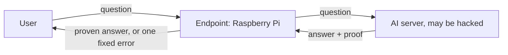

# Proof-gated endpoint

A Raspberry Pi checks cryptographic proofs before releasing an AI server's answers. The repository contains its software, threat model, attack catalogue and measurements.

A hacked server or rogue model could hide stolen model weights in answers. The endpoint requires proof that the approved model produced each answer from the user's question. Proofs fix content; timing, order and deliberate failures can still carry data.



Work in progress, supported by ERA's Frontier AI Security Residency, October to December 2026. This is not production security. Claims extend only as far as their named tests or measurements.

## Findings

<!-- BEGIN findings: copied from book/src/results.md; tests/test_docs.py fails if they differ -->
| Signal | Basic endpoint | Best result so far | Cost |
|---|---|---|---|
| Changed answer content | Blocked by proof | Blocked | About 0.24 s per check on the Pi |
| Reply order | Leaks | Tested ordering code blocked: replies follow question order | A slow reply delays later ones |
| Reply timing | Leaks | Much reduced. Fixed release prevents early replies; a small trace remained without spin. With spin, a 512-answer test was inconclusive on stock OS and found nothing on the stripped image, one run | 4.0 s per answer instead of about 0.8 s |
| Chosen failures | Leaks | Cap: 8 of 32 planted bits recovered instead of 32/32. Stopping at the first failure released nothing readable; pre-registered, 2 Nov | Cap: 54 of 128 answers ok instead of 120 during continued failures; an honest server loses none. Stopping answers nothing after the first failure |
<!-- END findings -->

These rates cover one tiny model on a Pi 4 and the hiding methods tried, one client at a time. They do not bound a better attacker.

## Status

<details><summary>Built, measured and planned versions</summary>

<!-- ANCHOR: status -->
| Version | What it is | Status |
|---|---|---|
| v0 | The checking software on the Pi's standard operating system | Done and measured |
| v1 | Stricter software in Rust (fixed message format, release in arrival order or at a fixed time, a failure cap, a sandboxed checker, fixed-word logs, signed updates) on a stripped-down, read-only system with one open port | Done and measured on the Pi, including the locked-down image with no login (2 Nov). The v1.1 image (3 Nov: the endpoint confines itself, the root is checked with dm-verity, the processor's speculative-execution protections are on, the kernel is trimmed further) boots in an emulator and awaits its Pi check |
| v2 | Secure boot, two physical ports, a counter against restoring an old update store, signed images | Planned |
<!-- ANCHOR_END: status -->

</details>

## Read and run

Start with the [Overview](book/src/introduction.md), then [How it works](book/src/tour.md). The book links [leakage](book/src/leakage.md), [hardening](book/src/hardening.md), [measurements](book/src/results.md), [limitations](book/src/limitations.md), specifications and evidence.

Build with [mdBook](https://github.com/rust-lang/mdBook) 0.5.4: `mdbook serve book`, then open http://localhost:3000.

```sh
uv venv --python 3.12 .venv
uv pip install --python .venv/bin/python "ezkl==23.0.5" onnx numpy pytest
.venv/bin/python -m pytest -q
```

Tests download and check the pinned setup file if `prover/artifacts/kzg.srs` is absent. Commands and requirements: [Reproduce](book/src/reproduce.md). Navigation: [repository map](book/src/repo-map.md), [glossary](book/src/glossary.md) and [attack catalogue](docs/ATTACKS.md).

## Scope

We harden and measure the endpoint, request binding, updates, secure boot and server-controlled signals, including packet sizes and headers. Proof-system soundness, physical attacks and what ordinary correct outputs reveal are outside scope. Physical exclusions include power and electromagnetic channels.
