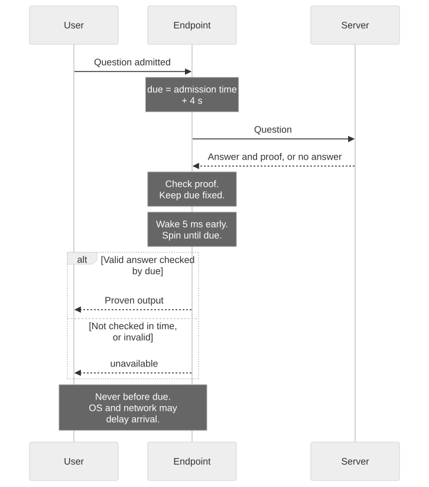

# What a hacked server can still leak

> **In short**
> - A proof fixes content. The server can still signal through timing, order and failures.
> - Arrival-order release stopped the ordering code we tried. Fixed release reduced timing leakage, at a cost in speed.
> - Failures still leak. A cap limits that channel but costs availability.

## Why a proof isn't enough

Think of a customs officer who checks each parcel against its paperwork. A smuggler can still choose when parcels arrive, their order, or which get rejected. An accomplice who knows the code can read those choices as a message.

These are [side channels](glossary.md): information carried by behaviour rather than content.

## How we tested it

We planted a known message in the server and tried to recover it outside the endpoint with a fixed decoder. Recovering every bit shows that the channel is open. A failed decoding attempt says only that this decoder missed this message in this run.

We tested three signals under three release rules on the real Pi, one client at a time. Fixed release used a 4 s budget. The ordering test had several questions in flight on one connection.

{{#include results.md:matrix}}

## Order

The server answers concurrent questions in a chosen order. The endpoint removes that choice by releasing replies in the order questions arrived. The observer then decoded the same bits whatever the server planted.

A slow answer holds up those behind it. See [release rules](tour.md#when-answers-leave) for the deadline behaviour.

## Timing

The server can answer quickly for a zero and slowly for a one. Under fixed release, the endpoint schedules each reply for admission time plus 4 s. Every user waits the full budget, even when the answer was ready earlier.

If checking has not finished by then, the reply is `unavailable`. That becomes a failure signal, covered below.

### Why did fixed release leave a trace?

The schedule is fixed, but the computer takes time to wake and send a packet. A late server answer leaves the processor busy checking a proof just before release. An early answer leaves it idle for seconds beforehand.

Our leading explanation is that these different processor states affect release precision. We have not isolated the cause. A [spin](glossary.md) wakes the timer early and busy-waits until release, keeping the processor awake.

{{#include results.md:no-spin-trace}}

{{#include results.md:spin-verdict}}

Random sleeps are not a cheaper fix. The server's delay still shifts reply times, and enough answers can reveal it. In our [random-sleep model](results.md#random-sleeps-instead-of-a-fixed-release-time-a-model-2-nov), leakage per answer shrinks only as the added wait grows.

## Failures

The server can send a bad proof for chosen questions. The message is in which answer fails, not just how many fail.

{{#include results.md:failure-leak}}

Longer messages require more failures or larger batches. The [scaling example](results.md#how-the-failure-code-scales) shows that trade-off.

{{#include results.md:failure-scaling}}

### What a cap can do

A deliberate failure looks like a genuine fault, so release rules cannot prevent it. The endpoint can cap failures, counting missed deadlines too, or stop answering successfully after a failure.

- If a window of N answers allows at most F failures, there are at most C(N,0) + ... + C(N,F) possible failure patterns. Their information is at most log2 of that count.
- Stopping at the first failure leaves N + 1 outcomes: no failure, or its position. This allows at most log2(N + 1) bits per window, provided someone controls when the endpoint restarts.

These bounds cover only the failure pattern under that policy. Timing needs separate accounting. The counters live in memory, so every restart starts a fresh window: the bound is per boot.

On the Pi, both cap settings reduced the recovered message while failures continued during cooldowns. An honest server under the same cap lost no answers. Stopping at the first failure released nothing readable in the registered test, but answered nothing afterwards.

That gives the server an off switch. The [cap-versus-stop experiment](results.md#failure-cap-versus-stopping-2-nov-protocol-3) gives the exact results and availability cost. The choice between counting failures and stopping remains open.

## Can packets carry extra data?

The server connection terminates at the endpoint. The endpoint writes a fresh, fixed-size reply on a separate client connection. It keeps only checked output values; it does not forward the server's packets. The server therefore cannot directly choose outside packet headers or reply sizes.

It still controls its timing, failures and how busy it keeps the endpoint. Under fixed release, every admitted question holds its slot until release. A state-machine test shows that server behaviour then cannot choose which other questions are refused because the queue is full.

That protection does not cover arrival-order release. Nor does it establish that outside packet details reveal nothing: those have not been measured. See the [delivery catalogue](attacks.md#delivery-whether-when-and-how-often-an-answer-arrives).

## What was fuzzing for?

A [parser](glossary.md) reads an incoming message. Fuzzing throws random and corrupted messages at it, checking that each is refused or re-encodes to exactly the same bytes.

This checks for crashes, confusion and alternative accepted encodings that could carry extra data. It tests message handling, not timing. See [Hardening](hardening.md) for the parser tests.

## What depends on this setup?

The [binding rules](binding-spec.md) tie a proof to its question and are specific to EZKL. Another proof system needs its own rules. Fixed-size messages, release rules and failure caps do not depend on the proof system.

Timing behaviour does depend on the hardware and operating system. We therefore measured the stock system and stripped image separately. The rates describe the hiding methods tested on one device and network, not the best possible attacker.

One registered three-client timing run was inconclusive. A check timed to overlap each release was not detected. Both were single runs; [Measurements](results.md) records their limits and the missing packet captures.

Physical attacks are outside scope: we assume the device sits within the datacenter's physical security. Secure boot, a TPM and a non-rollback counter are planned, not protection demonstrated against someone holding the board.
