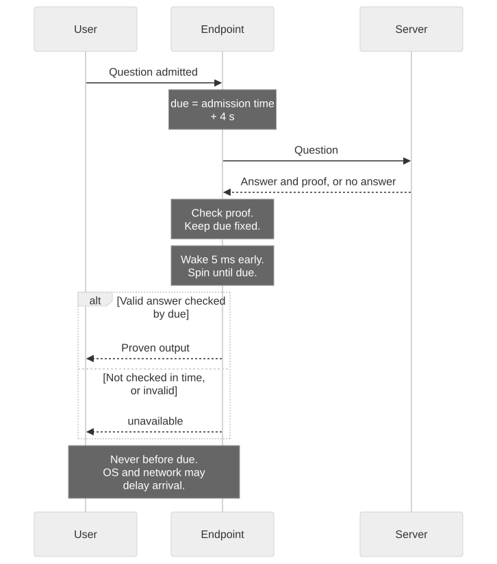

# Timing

> **In short**
> - The server can answer fast or slow on purpose; reply times then carry bits.
> - Fixed release sets a public target, but the endpoint can still send late.
> - A tiny trace remained without "spin"; measurements cannot prove a timing channel is gone.

## How the attack works

A hacked server controls when it sends each answer. It proves the answer correctly, then simply waits before sending it when it wants to signal a 1:

| Question | Secret bit | Server | The accomplice sees |
|---|---|---|---|
| 1 | 1 | waits a second, then answers | a slow reply: 1 |
| 2 | 0 | answers at once | a fast reply: 0 |
| 3 | 1 | waits a second | slow: 1 |

The endpoint cannot tell deliberate delay from honest slowness. An attacker can also try smaller delays, hidden in normal variation, and use statistics to recover them.

## The defence: fixed release

Under **fixed release**, the endpoint sets a target when it admits a question, meaning it accepts it for processing. The target is admission time plus a fixed budget. Our budget is 4 s.

| Question | Admitted | Answer checked | Earliest release |
|---|---|---|---|
| A | t | soon after | t + 4 s |
| B | t' | much later, but before t' + 4 s | t' + 4 s |
| C | t'' | not by t'' + 4 s | t'' + 4 s, as `unavailable` |

Fast or slow, the server cannot change that target. The endpoint never releases an admitted reply early, but its own processing and the network can delay delivery. There is no latest-send promise.

If checking has not finished by the deadline, the reply becomes `unavailable`: the [failure channel](failures.md). An `ok` decided before the deadline stays `ok` if fixed release runs late, unless a halt or cap overrides it.

The endpoint does not compute "4 s minus the verification time". At admission it records an absolute target on a monotonic clock, which is unaffected by changes to wall-clock time.

The cost: every admitted reply waits the full budget, even when the answer was ready much sooner. The budget must allow honest proving, transport and checking, or honest answers fail. A slower prover needs a longer budget.

## Why not a random delay?

A natural idea is to add a random wait, say between one and three seconds, to drown the server's delay in noise. We modelled this (`observer/sleep_vs_fixed.py`; a model, not a device run).

Suppose the server uses equally likely bits and delays only the 1-bits by d. The endpoint adds an independent, uniform random wait between 0 and R, with no other noise. When d is between 0 and R, replies in the overlapping windows reveal nothing; replies outside the overlap reveal the bit. The average information is d/R bits per answer, reaching one bit when the windows no longer overlap.

That exact result belongs to this model. Extra independent noise can reduce the information, and other delay distributions need their own analysis. Random waiting does not by itself remove the server's timing choice.

Every random-wait configuration in the table still showed a signal; ideal fixed release did not. A smaller follow-up simulation did not detect some of the random-wait signals. Both setups are in [Measurements](../results.md#random-sleeps-instead-of-a-fixed-release-time-a-model-2-nov).

{{#include ../results.md:random-sleeps}}

Ideal fixed release removes this delay choice when the answer is ready before the target. The device's clock scheduling is less simple, as the next experiment shows.

## The leftover trace

Fixed release stopped our one-second code, but a much finer test found a trace:

{{#include ../results.md:no-spin-trace}}

The reply targets were fixed, but observed times differed. Our leading explanation concerns how the processor acts on those targets. It is not proven:

- For a 1, the server answered a second later, so the endpoint finished checking that proof later. When the release time came, the processor had idled for a second less.
- For a 0, the server answered early, so the processor had idled longer. It may have entered a deeper rest and taken longer to wake.

A second possibility is that processor speed changed with load. Neither mechanism was isolated by these runs, so neither is an established cause.

## What "spin" means

A program can wait for a moment in two ways:

- **Sleep:** ask the operating system to wake it at the target time. Waking can be late.
- **Spin:** stay awake and check the clock in a loop until the target time. This avoids a sleep wake-up, but consumes processor time and can still be interrupted.

Our endpoint aims to wake 5 ms before release, then spins for at most 5 ms. A late wake-up shortens or skips that spin. The loop allows at most one spin per callback, so this is not a promise to spin before every reply under load.

Spin might reduce dependence on the processor's earlier state. The runs below do not establish that it caused the difference: they were taken on different days.

{{#include ../results.md:spin-verdict}}

## Load and several users

A server could also try to delay releases indirectly: time its answers so that a proof check runs exactly when another reply is due, or exploit several users at once. Two registered tests looked at this on the stripped image:

{{#include ../results.md:load-and-clients}}

Each was one run with one control. Stacked proof checks, floods and competing work on the same core were not tested. Packet captures were not taken.

A longer three-user test with six times the answers (protocol 6) was also inconclusive:

{{#include ../results.md:clients-p6}}

Two inconclusive results fit a very small trace with several users, or chance; a larger test or a better design is needed to tell. The run's disturbances are on [Measurements](../results.md#three-clients-with-six-times-the-answers-4-nov-protocol-6).

## Why measurements cannot prove timing is safe

"Not detected" is not "small". We estimated how large this encoder's shift in average reply time could be, using the measured data. We then converted that estimate to information under a Gaussian noise model, which assumes bell-shaped random variation:

{{#include ../results.md:timing-limits}}

This is a model-based confidence estimate, not a ceiling on every timing attack. Near zero shift, with similar noise, its estimated information limit falls roughly inversely with sample size. Other encodings or noise distributions can behave differently. Details are in [Measurements](../results.md#what-the-timing-data-can-rule-out-3-nov-analysis-of-earlier-runs).

## Two routes to a real bound

1. Remove the server's influence by design. A separate core or small scheduling chip might isolate the release stage from proof checking. Neither is established here as independent of server activity. A first test ran the release loop on its own core, but without spin this image showed no trace in either condition, so there was nothing to remove:

{{#include ../results.md:own-cpu}}

2. Charge for what is left. Petrie, Muhlhauser and Drotos propose committing to a predicted distribution of reply times and accounting for unexpected timing. Their paper, *Verifying AI Compute by Bounding Unexplained Information Exfiltration* (2026), also proposes fixed time windows. It describes an architecture, not a measured solution for this endpoint.

These routes could complement each other, but neither supplies a complete timing bound for this device today.
