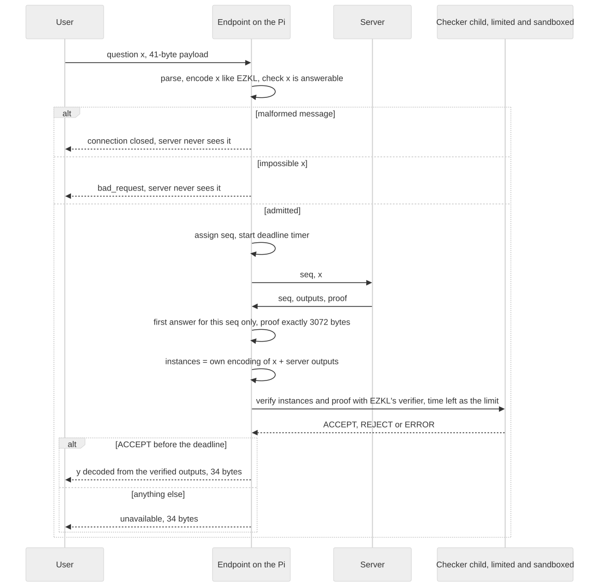

# How the endpoint works

> **In short**
> - The endpoint checks proofs against the question it received, not the server's account of it.
> - It writes fresh replies containing proven output or a fixed error, and controls their release.
> - Network handling, request tracking and proof checking form separate layers. The tables link each to its code and evidence.

## The pieces

The laptop currently plays both the AI server and the outside observer. The Pi runs the endpoint. It listens on the outside link and connects out to the server, with no server-facing listener.

The device runs one static Rust binary, without Python or the EZKL command-line tool. The Python endpoint is its reply-for-reply reference. Code names below are Python names; the Rust crates mirror them.

Code map

| Piece | Device (Rust) | Reference (Python) | Job |
|---|---|---|---|
| Endpoint loop | `endpoint/endpoint` | `pge/service.py` | Admits questions, forwards them, checks answers, decides when replies leave |
| Release rules and failure cap | `endpoint/core` | `pge/service.py`, `observer/cap_model.py` | A deterministic state machine: arrival or fixed release, halt, cap |
| Message format | `endpoint/wire` | `pge/protocol.py` | Fixed-size binary frames; strict parsing; one accepted form |
| Binding and checker | `endpoint/verify` | `pge/binding.py`, `pge/bundle.py`, `pge/domain.py`, `pge/cli.py` | Encodes questions like EZKL, pins the model, verifies with EZKL's library, decodes proven outputs |
| Signed updates | `endpoint/update` | none | Accepts a new model and policy only if signed, newer and for this device |
| Server | `prover/server.py` | | Proves each question with EZKL; can misbehave on purpose (tamper, replay, delay, hide bits) |
| Observer | `observer/client.py` | | Sends questions, records each reply and its arrival time, decodes hidden bits |

Both links share one Ethernet cable, separated only by address. A second wired port is planned for physical separation, with no forwarding between sides.

## The life of one question

The endpoint receives a question, forwards it and accepts only the first server answer for that sequence number. It reconstructs the proof's input from the question it received. Only verified outputs can become a reply.

- A malformed user frame closes that connection. An impossible question gets `bad_request` without reaching the server.
- A malformed server frame drops the server link and fails every pending question: it cannot be assigned to just one.
- The deadline is checked before verification starts and when it finishes. A late check cannot pass.
- Late, duplicate and unknown answers are counted and dropped. Each question gets one decision.

Steps and tests

| Step | Code | Evidence |
|---|---|---|
| Read and parse the question | `serve_client` and `parse_request` | `test_client_violation_closes_the_connection` |
| Encode, check, admit or refuse | `submit` | `test_bad_requests_never_reach_the_server` |
| Accept the first answer only | `on_answer` | `test_duplicate_answer_gives_one_reply`, `test_late_answer_is_dropped_and_answered_once` |
| Build instances, verify, decide | `_check` | `test_proof_for_another_request_is_blocked` |
| Decide when the reply leaves | `_release` and `_pump` | [When answers leave](#when-answers-leave) |

## How a proof is tied to the question

A proof says that a circuit transformed particular inputs into particular outputs. [Binding](glossary.md) connects that claim to this question, approved model and interpretation of the output.

1. Pin one [bundle](glossary.md): `settings.json`, `vk.key` and `kzg.srs`, each identified by SHA-256 and re-checked before verification. The server cannot select another model or key.
2. Encode the question exactly as EZKL does. A proof for a differently encoded question fails.
3. Read only verified output values. Never use a separately claimed answer or unbound `pretty_*`, `timestamp` or `hex_proof` fields.
4. Require exactly 3,072 proof bytes. EZKL otherwise accepts appended bytes, which could carry hidden data.
5. Refuse impossible questions before forwarding. They would otherwise give anyone a way to force failure. Their input-domain file is trusted configuration, outside the bundle's pinned hashes.

The [binding reference](binding-spec.md) records the pitfalls: unpinned output scales, incompatible Python rounding, server-supplied answers, padded proofs and impossible inputs. It also keeps the [worked numerical example](binding-spec.md#7-test-vectors) and exact encoding rules.

Binding covers the encoded value, not raw input identity. Different raw values can encode identically. Proofs have no nonce: duplicate delivery is blocked, but an old proof can answer a new, identically encoded question.

For this deterministic model, replay gives no output choice. It does not prove fresh computation.

The toy model is y = ReLU(xW + b), with 4 inputs and 3 outputs. It is small and deterministic because we study the endpoint, not the prover. A production prover can occupy the same place, but needs new binding rules and review, including encoding and randomness. Our rules cover EZKL 23.0.5 and these test models only.

## The checker

EZKL's verifier is compiled into the Rust binary as a library. Each check starts a fresh child of that binary with `--verify-child`. A child is a separate process whose crash, runaway allocation or hang can be contained.

The child gets a minimal environment. It reads model files and the proof from a pipe, re-checks their hashes and needs no file access. After lowering its limits, it installs a Linux system-call allow-list.

Every checker limit

| Limit | Value | Why |
|---|---|---|
| Address space (Linux only) | 256 MiB | Stops a proof that makes the verifier allocate without bound |
| CPU time | up to the deadline | A second stop for a busy loop, besides the wall-clock deadline |
| File size | 0 | The check writes no files |
| Open files | 64 | Bounds file-handle exhaustion |
| Core dumps | off | No memory dumps on disk |
| System calls (Linux) | an allow-list of the calls a check was traced making | No files, sockets, programs, new processes or executable memory; another architecture's calls kill it |
| Threads | Rayon set to 1 (a setting, not an OS limit) | Less memory, steadier timing |
| Output | 64 KiB, then SIGKILL | A flooding child can't exhaust the endpoint |
| Wall time | the time left until the deadline | Then SIGKILL of the whole process group |

ACCEPT requires exit 0 and exactly `accept`; REJECT requires exit 1 and exactly `reject`. Anything else is ERROR, including a killed child. Only ACCEPT releases output. ERROR counts as server failure.

The watchdog kills the whole process group at the deadline. These controls do not establish verifier correctness: a false ACCEPT still passes. The allow-list contains a taken-over checker, not a wrong cryptographic verdict.

The Python reference uses EZKL's command-line tool instead. [Measurements](results.md#checking-one-proof) gives its memory-limit reliability and the full cost breakdown. The Rust timings are [recorded separately](results.md#the-rust-endpoint-on-the-pi-29-oct).

## The message format

A frame is a 4-byte length followed by its payload. Questions and replies have fixed sizes for the pinned model. Server answers add a proof of exactly the pinned length.

Wire layout for the test model

| Message | From, to | Payload (test model) | Contents |
|---|---|---|---|
| Question | user to endpoint | 41 bytes (45 with the length) | type 1, id (8 bytes), 4 float64 inputs |
| Forwarded question | endpoint to server | 41 bytes | type 2, seq (8 bytes), the same inputs |
| Answer | server to endpoint | 105 bytes + proof | type 3, seq, 3 output field elements of 32 bytes, then the proof (up to 64 KiB on the wire, must be exactly 3,072 bytes) |
| Reply | endpoint to user | 34 bytes (38 with the length), success or error alike | type 4, id, status (0 ok, 1 bad_request, 2 unavailable), 3 float64 outputs (all zero unless ok) |

The parser rejects wrong lengths, unknown types, non-finite numbers and ids or sequence numbers at least 2^53. Frames must arrive fully within the deadline, and ids must strictly increase on each connection.

Tests try 10,500 random and mutated messages per parser. Accepted messages must re-encode identically. Other tests split frames at random points and check the proof-field boundary: 65,536 bytes accepted, 65,537 refused. The [service specification](service-spec.md) gives the exact rules.

## When answers leave

Each question moves through pending, checking and decided states. Release rules determine when a decided answer leaves.

| Rule | Release | Cost or limit |
|---|---|---|
| Immediate, v0 | As soon as decided | Stops none of the signals |
| Arrival, v1 binary default | After every earlier question's reply | A slow answer delays those behind it, up to its deadline |
| Fixed | Arrival order, never before admission + deadline; tests use 4 s | Every answer waits the budget; unfinished checks become `unavailable` |
| Fixed with 5 ms spin | Wake 5 ms early, busy-wait until release | Some CPU cost; each loop callback blocks for at most the spin |

Arrival order removes the server's choice of order. Fixed release also stopped the timing codes tried. Spin showed no average sub-millisecond shift; whether a weaker trace remains is unresolved. See [the leakage evidence](leakage.md).

At most `max_pending` (default 32) questions can wait, including held replies. Excess questions get `unavailable` immediately.

Halt is optional and off by default (`--halt-after N`). After N server-caused failures, held, pending and future replies become `unavailable`. Errors keep flowing: halting gives the server an off switch, and its position and error timing still leak.

[Review found release bugs](hardening.md#bugs-found-by-review), all fixed with regression tests: late successes after halt or deadline, uncounted held answers, spin reordering and chained busy-waits.

## From v0 to v2

Each version removes ways into the device and is measured the same way. v0 and v1 have Pi measurements; v2 is planned.

Versions and components

|  | v0 (measured) | v1 (measured) | v2 (planned) |
|---|---|---|---|
| Operating system | Raspberry Pi OS Lite (Debian 13) | Buildroot 2025.02.18 LTS: kernel 6.6, BusyBox init, read-only root; the endpoint is one static binary | as v1, inside a signed boot image |
| Endpoint | Python, EZKL command-line tool | Rust, EZKL verifier as a library, unprivileged user, sandboxed checker | as v1 |
| Network | one port, ssh and mDNS listening | one open port behind a firewall built into the kernel; the endpoint won't start without its rules | two physical ports, nothing forwarded |
| Updates | copy files over ssh | signed model and policy in a store on a data partition; a new update comes as a new image or is applied to the card offline | as v1, plus a counter that can't roll back |
| Login | ssh, HDMI, serial | none (from the 2 Nov rebuild; until then a console login) | none |

### Building v1

`image/build.sh` runs in a Linux VM because Buildroot does not build on macOS. It:

- Downloads Buildroot and verifies its SHA-256.
- Starts from `raspberrypi4_64_defconfig`.
- Adds the static endpoint, firewall and fixed address through `image/v1.fragment`.
- Applies the signed update to the store as the device would.
- Checks that every added option, including kernel options, survived the build.

The 2 Nov rebuild removes login prompts and [locks down the kernel](hardening.md#6-reach-the-operating-system). It booted with both start-up checks passing and only port 8700 reachable.

A clean-runner build matched user-space files apart from build metadata. v1.1 is reproducible across the laptop and two CI builds, including the kernel, except for signing-key-dependent files. [Measurements](results.md#attack-surface) keeps the comparisons and distinguishes built from boot-tested images.

v1 still lacks a second physical port and on-device update delivery.

### Secure boot: v2, planned

The key hash is permanent, so secure boot needs a spare Pi, not the development board. The boot ROM and EEPROM bootloader check an image containing the kernel, system and endpoint. Modified or unsigned images should not boot under this design.

Versioned packages use update keys, forward-only version checks and installation that survives power loss at every step, following The Update Framework's approach. Boot signing, update signing and model approval use separate keys.

The Pi lacks a battery-backed clock. After reboot, it cannot know its version's age; blocking updates can therefore keep it on an old version. This design follows Raspberry Pi documentation. No secure-boot experiment has run.

## Who attacks it

The main attacker is a hacked AI server or a model acting against its owners, paired with an outside observer. Network attackers and holders of signing keys also matter.

We protect the weights and the controls on released information: model bundle, endpoint code and settings, release rules and logs. Every outside route is assumed to cross the endpoint; v0 does not enforce this. We assume sound proofs and exclude physical attacks.

The [threat model](threat-model.md) lists each signal and its status. [Hardening](hardening.md) covers logs and access controls; [Leakage](leakage.md) covers timing, failures, ordering, queue pressure and packet limits.

{{#include ../../docs/ATTACKS.md:summary}}

## Measuring what still leaks

We plant bits in server behaviour, then compare them with an outside observer's decoding. Failure to recover a message does not rule out a smarter decoder.

| Encoder in `prover/server.py` | Method |
|---|---|
| `timing_bits` | Delay an answer by 1 s for each one bit |
| `order_bits` | Order 3 concurrent answers; the permutation index carries 2 bits |
| `fail_position` | Tamper one output per block of 16; its position carries 4 bits |

The [glossary](glossary.md) explains permutation tests, held-out decoding, mutual information and honest controls. [Measurements](results.md) records every result, run condition and statistical caveat.
